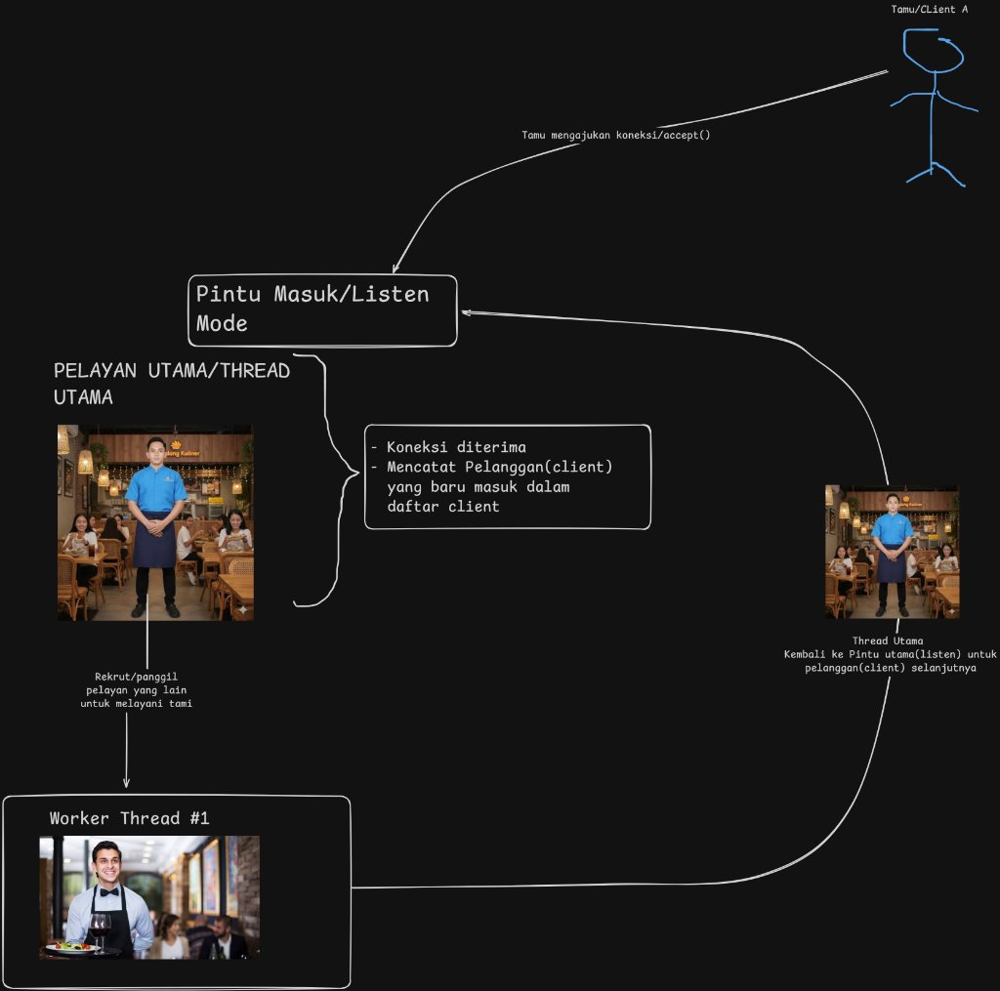
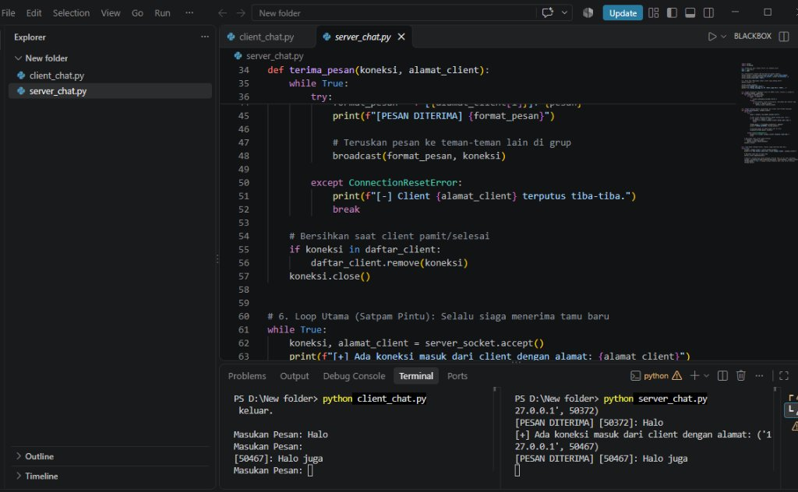
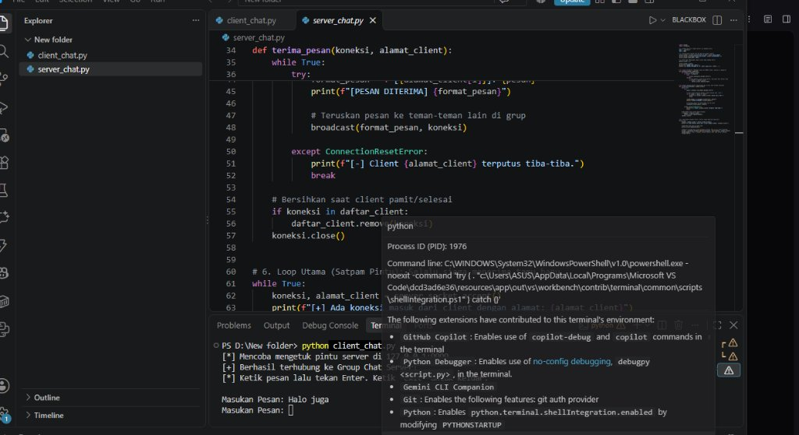
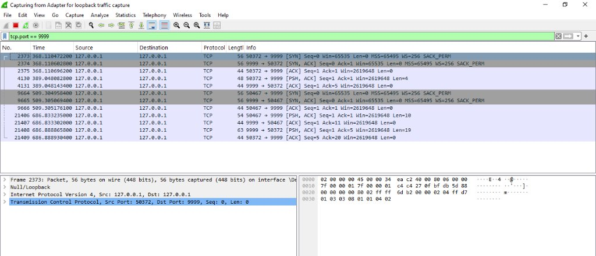
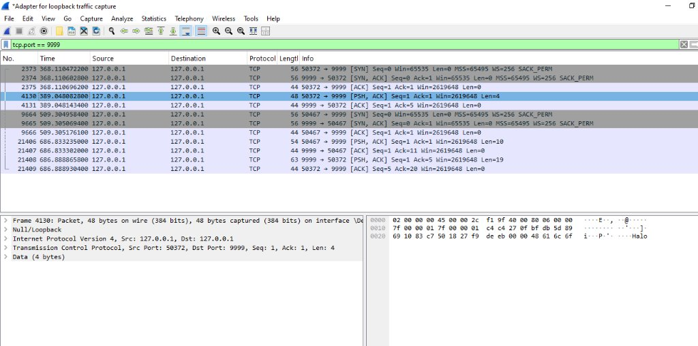

# 💬 Multi-Client Chat Architecture & Packet Forensic Analysis

Project ini bukan sekadar membuat aplikasi chat sederhana, melainkan studi kasus menyeluruh untuk membongkar **bagaimana data benar-benar bergerak di jaringan komputer**, mulai dari baris kode program, sistem antrean di sistem operasi, hingga pembuktian langsung di level bit/paket menggunakan **Wireshark**.

---

## 🎯 Mengapa Project Ini Dibuat?

Banyak orang bisa membuat kode chat, tapi sedikit yang paham apa yang terjadi di balik layarnya:
* Mengapa butuh **IP Address** dan **Port** sekaligus?
* Apa yang terjadi saat dua komputer jabat tangan (**TCP 3-Way Handshake**)?
* Bagaimana sebuah Server bisa melayani banyak orang sekaligus tanpa macet (**Threading & Concurrency**)?
* Seperti apa bentuk fisik pesan teks saat mengalir di kartu jaringan?

Project ini menjawab pertanyaan-pertanyaan tersebut secara tuntas melalui **kode nyata** dan **bukti tangkapan paket (Packet Sniffing)**.

---

## 🍽️ Analogi Restoran: Memahami Arsitektur Multi-Client

Agar mudah dipahami oleh siapa saja tanpa bahasa teknis yang rumit, arsitektur server chat ini dirancang dengan prinsip **Manajemen Restoran Populer**:



### Unsur-Unsur Jaringan dalam Restoran:

1. **Alamat Restoran (IP Address `127.0.0.1`)**: Alamat fisik bangunan restoran agar para tamu tahu ke mana mereka harus menuju.
2. **Nomor Pintu Masuk (Port `9999`)**: Pintu utama restoran tempat staf bersiap menyambut tamu.
3. **Nomor Meja Tamu (Ephemeral Port, misal `50372`)**: Nomor meja sementara yang diberikan oleh sistem operasi (Windows) kepada tamu saat tiba, agar pesanan balik tidak salah antar.

---

### Alur Kerja (Workflow) Pelayan di Balik Layar:

1. **Pintu Masuk Siaga (`Listen Mode`)**:
   Pelayan Utama (*Main Thread*) berdiri tegak di depan pintu restoran, memasang telinga (*listening*) menunggu kedatangan pengunjung.
   
2. **Tamu Mengetuk Pintu (`connect`) & Disambut (`accept`)**:
   Pengunjung/Client datang dan mengetuk pintu (`connect()`). Pelayan Utama langsung membukakan pintu dan menyambut tamu tersebut (`accept()`).
   
3. **Mencatat ke Buku Tamu (`daftar_client`)**:
   Sebelum tamu dipersilakan masuk, Pelayan Utama mencatat identitas jalur koneksi tamu tersebut ke dalam buku tamu (*list `daftar_client`*).
   
4. **Merekrut Pelayan Khusus Meja (`Worker Thread #1`)**:
   Pelayan Utama tidak menemani tamu tersebut makan/ngobrol. Sebaliknya, ia langsung memanggil seorang pelayan khusus (*Worker Thread*) untuk mendampingi tamu itu secara privat di mejanya.
   
5. **Pelayan Utama Segera Kembali ke Pintu**:
   Detik itu juga, Pelayan Utama langsung berbalik arah kembali ke pintu depan (`Listen Mode`) untuk bersiap menyambut tamu berikutnya. Karena itu, restoran ini tidak pernah membuat tamu baru mengantre berlama-lama di luar!
   
6. **Mekanisme Broadcast (Berbagi Cerita Antar-Meja)**:
   Saat Tamu di Meja 1 berbicara: *"Halo semua!"*, pelayan khususnya mendengarkan (`recv()`), lalu melihat ke Buku Tamu dan menyampaikan pesan tersebut ke pelayan-pelayan di meja lainnya, sehingga semua pengunjung restoran bisa mendengar obrolan tersebut secara *real-time*.

---

## 📸 Bukti Pengujian Sistem (Live Terminal)

Berikut adalah pengujian saat Server melayani dua Client sekaligus secara *real-time*:



* Client 1 (Port `50372`) mengirim pesan: *"Halo"*.
* Client 2 (Port `50467`) menerima pesan tersebut dan membalas: *"Halo juga"*.
* Server sukses mendistribusikan percakapan tanpa tabrakan.

### Inspeksi Proses Sistem Operasi (OS Process Tracking)

Setiap sesi komunikasi dikelola secara independen oleh Windows dengan nomor proses (*Process ID / PID*) unik:



Hal ini membuktikan bahwa aplikasi berjalan sebagai proses mandiri di sistem operasi yang mengelola *socket handles* secara aman.

---

## 🔍 Bukti Forensik Jaringan (Analisis Wireshark)

Untuk membuktikan bahwa sistem ini bekerja sesuai standar protokol internet, lalu lintas data lokal direkam menggunakan **Wireshark** pada antarmuka *Loopback Adapter*.

### 1. Bukti Tiga Kali Jabat Tangan (TCP 3-Way Handshake)

Sebelum pesan chat bisa dikirim, komputer wajib melakukan "salam perkenalan" 3 arah:



Perhatikan 3 baris pertama pada rekaman di atas:
1. **Paket 1 (`[SYN]`)**: Client (`Port 50372`) mengetuk Server (`Port 9999`): *"Halo, saya mau konek."*
2. **Paket 2 (`[SYN, ACK]`)**: Server membalas: *"Halo juga, pintu 9999 siap menerima kamu."*
3. **Paket 3 (`[ACK]`)**: Client mengonfirmasi: *"Siap, mari kita mulai ngobrol!"*

Status koneksi resmi menjadi **ESTABLISHED**.

---

### 2. Membedah Isi Paket Data (Payload Inspection)

Apakah teks chat kita benar-benar lewat di kabel? Mari kita intip paket data nomor **4130**:



**Temuan Menarik:**
* **Bendera `[PSH, ACK]`**: Tanda *Push*, menginstruksikan TCP untuk segera mendorong data ke aplikasi tanpa ditunda.
* **Panjang Data (`Len=4`)**: Panjang muatan tepat **4 byte**.
* **Deretan Heksadesimal**:
  * `48` = Huruf **H**
  * `61` = Huruf **a**
  * `6c` = Huruf **l**
  * `6f` = Huruf **o**
* Teks `"Halo"` terbaca telanjang di lapisan paling dalam paket TCP!

---

## 🛠️ Cara Menjalankan Project Ini

### Persyaratan:
* Python 3.x terpasang di komputer.

### Langkah Menjalankan:

1. **Jalankan Server (Terminal 1)**:
   ```cmd
   python server_chat.py
   ```
2. **Jalankan Client 1 (Terminal 2)**:
   ```cmd
   python client_chat.py
   ```
3. **Jalankan Client 2 (Terminal 3)**:
   ```cmd
   python client_chat.py
   ```
4. Ketik pesan di salah satu terminal, dan pesan akan langsung terkirim ke terminal lainnya! Ketik `exit` untuk keluar secara rapi.

---

## 💡 Apa yang Dipelajari dari Project Ini?

* **Pola Pikir Problem Solving**: Memahami arti error seperti `Connection Refused` (apakah masalah di kabel jaringan atau servis/aplikasi tujuan yang mati).
* **Network Encapsulation**: Bagaimana data dibungkus dari Layer Aplikasi -> Transport (TCP) -> Network (IP) -> Data Link (MAC).
* **Concurrency**: Mengatasi batasan proses *single-threaded* menggunakan *Multi-Threading*.
* **Packet Inspection**: Menggunakan Wireshark sebagai alat diagnosis dan audit jaringan profesional.
